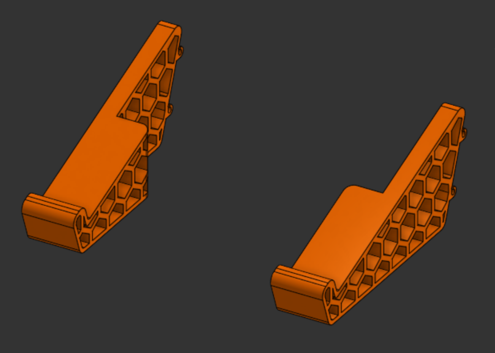

# keeb-stand
Keeb Stand is a simple and light-weight stand to mount your keyboard for easy access and incline.

## What is this?
Keeb Stand is a simple and sleek keyboard stand. Designed from scratch in Onshape, it has a very comfortable and fixed angle of incline for your keyboard. It shares the same color as the previously designed [Phone Stand](https://github.com/vd-sh/phone-stand). Being compatible with many keyboards, this also has hooks at the upper end to lock in any lying cables (<2mm) and make sure the setup looks clean.



## Repository Structure
```text
keeb-stand/
|
|---- Assets/-----------# Images and visual references for the project
|
|---- Hardware/---------# Source design files for the CAD
|
|---- LICENSE-----------# MIT License
|
|---- README.md---------# Project documentation and instructions
```

## Live 3d view in Onshape
Click [here](https://cad.onshape.com/documents/958384e744093b0ab69d41c5/w/87040f7a5fc41575464cf7d8/e/0006c10da244022ab637c10a) to view Phone Stand in Onshape!

## How to get your own Keeb Stand?
1. Download the source CAD .step files from the [Hardware](Hardware/) directory
2. Import the file into your CAD editor and make edits as you want (Optional)
3. Go to your fabricater/ manufacturer website, get a quote, and purchase it (For Example, [ROBU](https://robu.in) or [JLCPCB](https://jlcpcb.com))
4. That's it! Wait for it to arrive and mount your keyboard!

## Fabrication Specs
1. Printer- 0.2 mm Standard Quality
2. Material- PLA
3. Color- Orange
4. Infill- 60%

## License
[MIT](LICENSE)- Use, modify, share as you like!

## Notes
- If ya'll like this project, make sure to see my other projects [Phone Stand](https://github.com/vd-sh/phone-stand), [Deskr](https://github.com/vd-sh/deskr), or [Cync](https://github.com/vd-sh/cync)
- Or simply visit my [profile](https://github.com/vd-sh) to see the latest projects :)
